#  JIT Access — Plateforme de gestion des accès privilégiés Just-In-Time pour les ressources cloud AWS

> Conception et implémentation d'une plateforme qui accorde des privilèges AWS **uniquement quand ils sont nécessaires, pour une durée limitée et après vérification de la légitimité de la demande** (*Zero Standing Privilege*).


Projet de Fin d'Année réalisé au sein du **Centre Code212 (Université Cadi Ayyad)** — ENSA Marrakech, filière Cyberdéfense et Systèmes de Télécommunications Embarqués.
Période : du 17/07/2026 au 31/08/2026 · Année universitaire 2025–2026 · Auteure : **Aya Isedrhas**.

---

##  Sommaire

1. [Contexte et problématique](#-contexte-et-problématique)
2. [Fonctionnalités](#-fonctionnalités)
3. [Architecture](#-architecture)
4. [Workflow d'une demande d'accès](#-workflow-dune-demande-daccès)
5. [Stack technique](#-stack-technique)
6. [Structure du projet](#-structure-du-projet)
7. [Configuration des composants](#-configuration-des-composants)
8. [Installation et lancement](#-installation-et-lancement)
9. [Démonstration](#-démonstration)
10. [Traçabilité avec Splunk](#-traçabilité-avec-splunk)
11. [Choix de sécurité](#-choix-de-sécurité)
12. [Limites et perspectives](#-limites-et-perspectives)

---

##  Contexte et problématique

Dans beaucoup d'organisations, les comptes à privilèges élevés restent actifs en permanence : ce sont des **privilèges permanents** (*standing privileges*). Ils élargissent la surface d'attaque, car un compte compromis donne un accès durable, et rendent l'audit difficile.

Cette plateforme applique le principe du **Just-In-Time Access** :

| Modèle classique | Modèle JIT (ce projet) |
|---|---|
| Droits AWS attribués en permanence | Aucun droit permanent |
| Justification implicite | Justification obligatoire via un **ticket Jira** |
| Règles d'accès dans le code ou dans la console | Règles centralisées en **Policy-as-Code (Rego)** |
| Mot de passe seul | Keycloak **+ TOTP** |
| Clés IAM longue durée | Identifiants **AWS STS** temporaires |
| Traçabilité partielle | Chaque décision est journalisée dans **Splunk** |

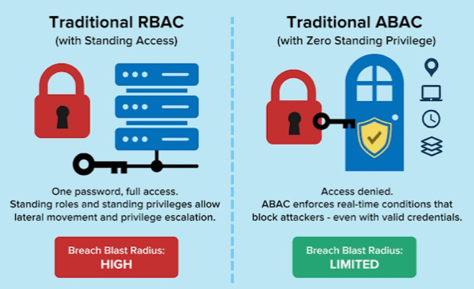
*Comparaison entre le modèle de privilèges permanents et le modèle Zero Standing Privilege.*


*Principe du Just-In-Time Access.*

---

##  Fonctionnalités

- 🔑 **Authentification SSO** via Keycloak (OpenID Connect, Authorization Code + PKCE).
- 🎫 **Justification par ticket Jira** : le ticket doit exister, être actif et être assigné au demandeur.
- 📜 **Autorisation par OPA** (Policy-as-Code) : refus par défaut (*fail-closed*).
- 📱 **MFA TOTP** exigée avant tout appel à AWS, avec enrôlement par QR code.
- ☁️ **Accès temporaires AWS** via `sts:AssumeRole` (rôles S3 lecture / écriture).
- 💻 **Agent local** qui injecte les identifiants dans une session PowerShell dédiée, sans jamais les afficher dans le navigateur.
- ⏱️ **Expiration automatique** : la session PowerShell est fermée à l'échéance des credentials STS.
- 📊 **Journalisation** de chaque étape dans Splunk, corrélable par `request_id`.

---

##  Architecture

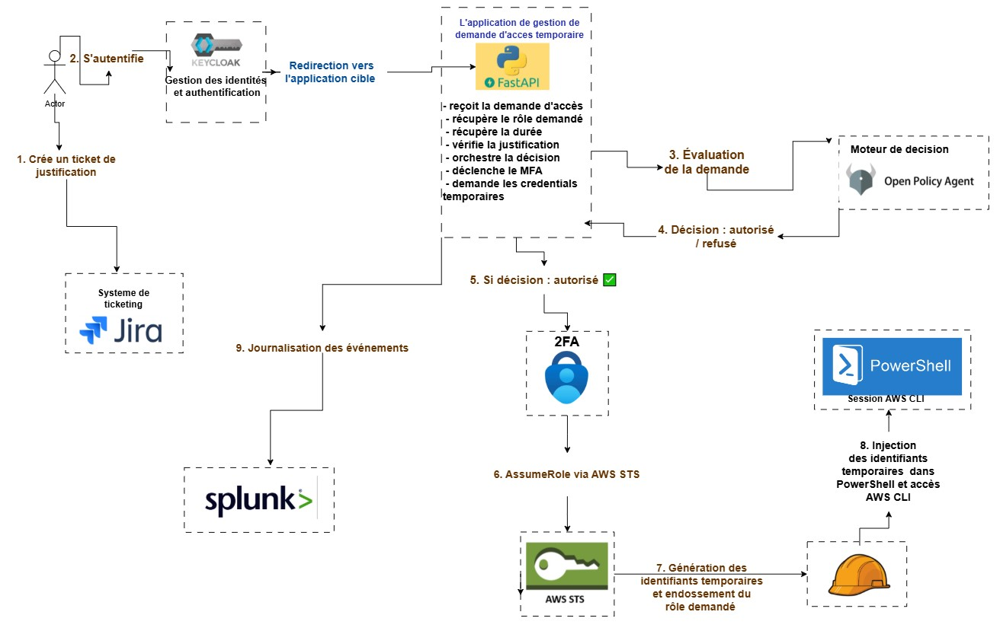
*Architecture globale de la plateforme de gestion des accès temporaires Just-In-Time.*

Les responsabilités sont séparées :

| Composant | Rôle | Ne fait **pas** |
|---|---|---|
| **Keycloak** | Authentifie l'utilisateur, émet le JWT avec ses rôles métier | N'autorise aucun accès AWS |
| **Jira** | Fournit le contexte métier (statut, priorité, assigné) | Ne décide rien |
| **OPA** | Décide d'autoriser ou de refuser la demande | N'authentifie personne |
| **Backend FastAPI** | Orchestre le workflow, valide les JWT, appelle STS | Ne contient aucune règle d'autorisation |
| **AWS STS** | Génère les identifiants temporaires du rôle demandé | |
| **Agent local** | Récupère les credentials et ouvre la session PowerShell | |
| **Splunk** | Collecte les événements pour l'audit | N'influence jamais une décision |

---

##  Workflow d'une demande d'accès


1. Création d'un ticket Jira justifiant le besoin.
2. Authentification Keycloak.
3. Soumission de la demande (rôle temporaire, ressource, ticket, durée).
4. Vérification du ticket Jira.
5. Évaluation par OPA.
6. Authentification multifacteur (TOTP).
7. Appel à AWS STS (`AssumeRole`) et génération des identifiants temporaires.
8. Récupération sécurisée par l'agent local (`launch_token` à usage unique).
9. Injection des identifiants dans une session PowerShell, puis utilisation de l'AWS CLI.
10. Journalisation de chaque étape dans Splunk.

> 💡 **La MFA n'est demandée qu'après la décision positive d'OPA**, pour ne pas solliciter un second facteur sur une demande qui serait de toute façon refusée.

---

##  Stack technique

| Domaine | Technologie |
|---|---|
| Identité et SSO | Keycloak, OpenID Connect, OAuth 2.0, PKCE, JWT / JWKS |
| Décision d'accès | Open Policy Agent, Rego (ABAC, Policy-as-Code) |
| Justification | Jira Cloud (API REST v3) |
| Backend | Python, FastAPI, Pydantic, httpx |
| Cloud | AWS IAM, AWS STS, boto3, Amazon S3 |
| MFA | TOTP, pyotp, application d'authentification mobile |
| Observabilité | Splunk, HTTP Event Collector (HEC) |
| Conteneurisation | Docker, Docker Compose, PostgreSQL (base de Keycloak) |
| Frontend | HTML, CSS, JavaScript, keycloak-js |
| Poste de travail | Agent local Python, PowerShell, AWS CLI |
| Transport | TLS, certificats auto-signés (développement) |

<p align="center">
  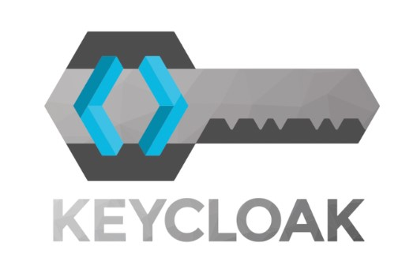
  
  
  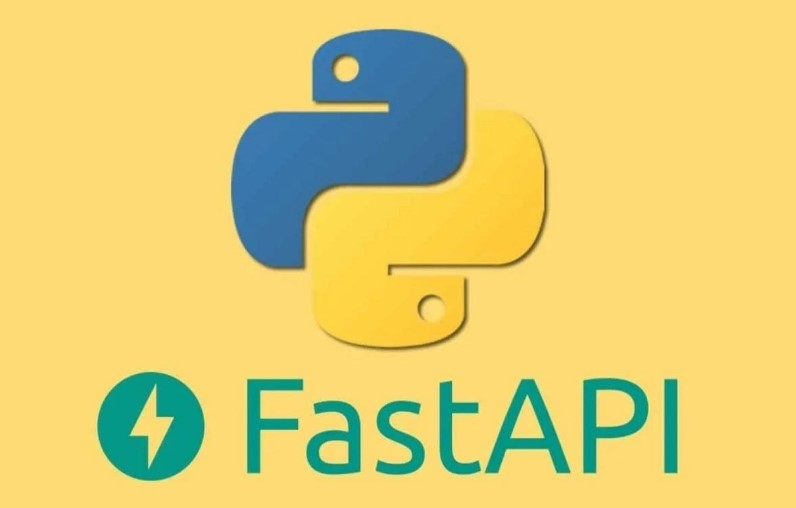
  
  
  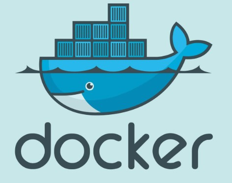
  
</p>

---

##  Structure du projet

```text
jit-access/
|
|-- backend/
|   |-- main.py                  # API FastAPI, orchestration du workflow
|   |-- auth.py                  # Validation des JWT Keycloak (JWKS, RS256)
|   |-- models.py                # Modèles Pydantic (demande, code MFA, rôles)
|   |-- session_store.py         # Stockage temporaire + launch_token à usage unique
|   |-- requirements.txt
|   `-- services/
|       |-- jira_service.py      # Récupération du ticket Jira
|       |-- opa_service.py       # Appel à OPA
|       |-- mfa_service.py       # Génération et vérification TOTP
|       |-- aws_service.py       # AssumeRole via boto3
|       `-- splunk_service.py    # Envoi des événements au HEC
|
|-- frontend/
|   |-- index.html               # Écrans : login, demande, MFA, résultat
|   |-- style.css
|   |-- config.js                # URLs Keycloak, backend, agent
|   `-- app.js                   # Logique navigateur, keycloak-js, MFA
|
|-- opa/
|   `-- policies/
|       `-- jit_authz.rego       # Politique d'autorisation
|
|-- certs/
|   |-- localhost.crt
|   `-- localhost.key
|
|-- scripts/
|   `-- generate_local_cert.py   # Génère les certificats auto-signés
|
|-- agent_jit.py                 # Agent local (HTTPS) + session PowerShell
|-- docker-compose.yml           # PostgreSQL, Keycloak, OPA, Splunk
|-- serve_frontend_https.py      # Sert le frontend en HTTPS
|-- start_backend_https.ps1      # API sur le port 8000
|-- start_frontend_https.ps1     # Interface sur le port 5500
`-- start_agent.ps1              # Lance l'agent local
```

---

##  Configuration des composants

### 1. Keycloak

Un realm **`jit-realm`** isole les utilisateurs, clients et rôles du projet.

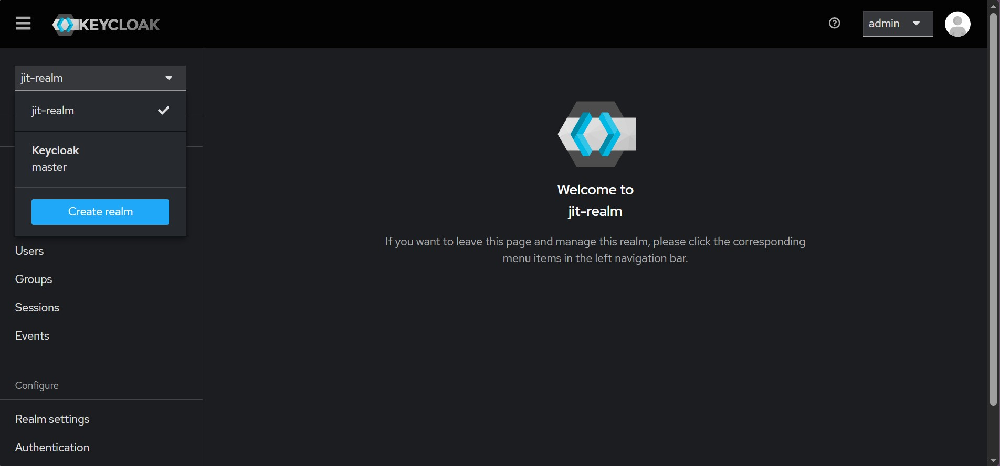

Deux clients OpenID Connect :

| Paramètre | `jit-frontend` | `jit-backend` |
|---|---|---|
| Type | Public | Confidentiel |
| Flow | Authorization Code + PKCE (`S256`) | Validation JWKS |
| Redirect URI | `https://127.0.0.1:5500/*` | — |
| Usage | Authentification navigateur | Vérification des tokens |

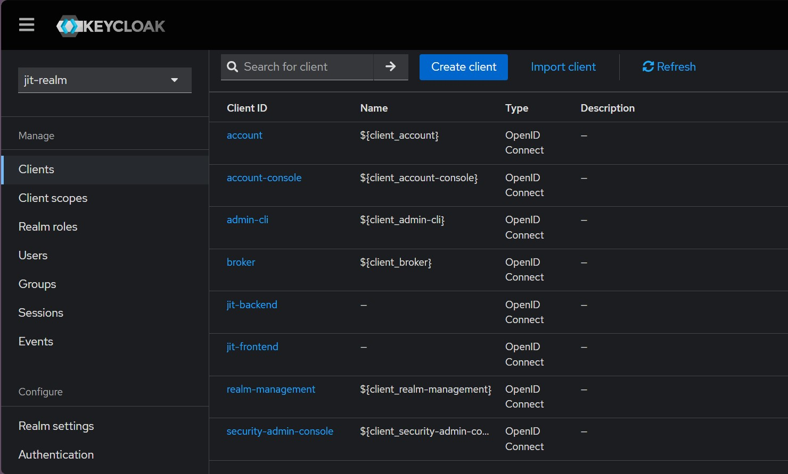

Rôles métier créés dans le realm (présents dans le claim `realm_access.roles`) :
`devops-engineer`, `backend-developer`, `system-administrator`, `qa-engineer`, `security-analyst`, `hr-specialist`.

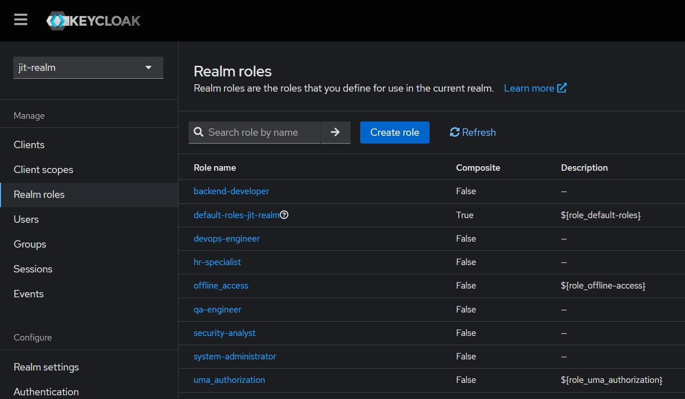

Configuration du frontend :

```js
const KEYCLOAK_CONFIG = {
  url: "http://localhost:8080",
  realm: "jit-realm",
  clientId: "jit-frontend",
};
```

Le backend valide la signature des jetons (`RS256`) avec les clés publiques exposées par :

```text
GET /realms/jit-realm/protocol/openid-connect/certs
```

### 2. Open Policy Agent

OPA tourne en conteneur (port `8181`) et charge les politiques depuis `opa/policies`.

```yaml
opa:
  image: openpolicyagent/opa:latest
  command: ["run", "--server", "--addr=:8181", "/policies"]
  ports:
    - "8181:8181"
  volumes:
    - ./opa/policies:/policies
```

Le backend interroge la règle `allow` du package `jit.authz` :

```text
POST /v1/data/jit/authz/allow
{ "input": { "user": {...}, "request": {...}, "ticket": {...}, "context": {...} } }
```

La demande n'est acceptée que si **toutes** les conditions suivantes sont vraies (`default allow := false`) :

```rego
package jit.authz

default allow := false

allow if {
    role_can_request_this
    ticket_is_active
    ticket_assigned_to_requester
    priority_is_sufficient
    duration_within_limit
    duration_above_minimum
    is_within_business_hours
}
```

| Règle | Contrôle |
|---|---|
| `role_can_request_this` | Le rôle métier autorise le rôle temporaire demandé |
| `ticket_is_active` | Statut du ticket : `A faire` ou `En cours` |
| `ticket_assigned_to_requester` | Assigné = e-mail de l'utilisateur authentifié |
| `priority_is_sufficient` | `Highest`, `High` ou `Medium` (pas `Low` / `Lowest`) |
| `duration_above_minimum` | Au moins **15 min** (minimum accepté par AWS STS) |
| `duration_within_limit` | Au plus **240 min** (4 h) |
| `is_within_business_hours` | Plage horaire 9 h – 17 h, fuseau `Africa/Casablanca` |

Matrice rôle métier → rôles temporaires autorisés :

| Rôle métier (Keycloak) | Rôles temporaires autorisés |
|---|---|
| `devops-engineer` | `s3-write-access`, `s3-read-access` |
| `backend-developer` | `s3-write-access`, `s3-read-access` |
| `system-administrator` | *voir `jit_authz.rego`* |
| `qa-engineer` | `s3-read-access` |
| `security-analyst` | `s3-write-access`, `s3-read-access` |
| `hr-specialist` | aucun |

### 3. Jira

Un espace **`JIT-Access`** regroupe les tickets de demande (clés `JIT-1`, `JIT-2`, …). Le backend lit uniquement la clé, le statut, la priorité et l'assigné.

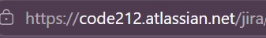
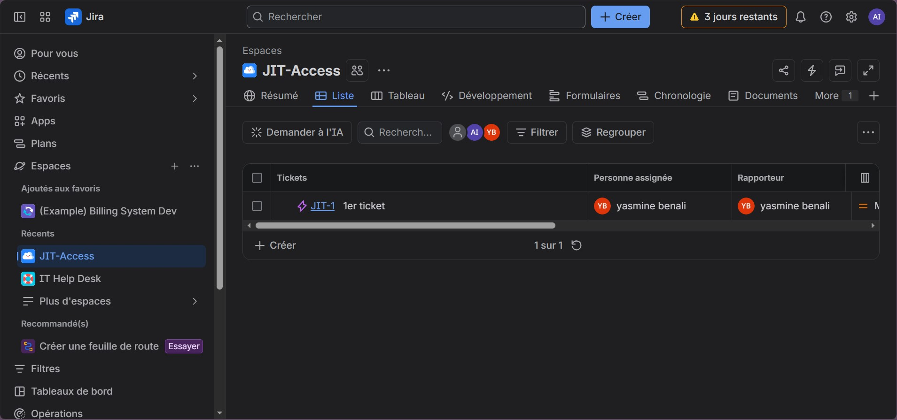
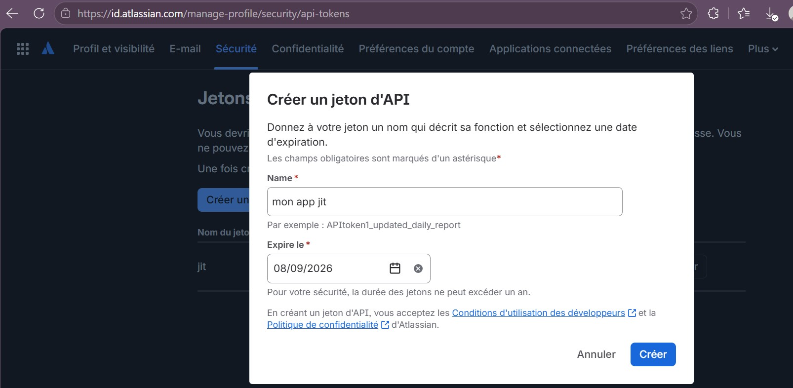

Les paramètres restent côté backend, jamais côté frontend :

```env
JIRA_BASE_URL=https://code212.atlassian.net
JIRA_EMAIL=<service-account-email>
JIRA_API_TOKEN=<api-token>
```

Si le ticket est introuvable ou si Jira est injoignable, la demande est refusée (*fail-closed*).

### 4. MFA TOTP

Le secret TOTP est généré à l'enrôlement et présenté sous forme de QR code. Le code saisi est vérifié côté backend. Le code lui-même n'est jamais journalisé. Aucun appel à STS n'a lieu tant que la MFA n'a pas réussi.

### 5. AWS IAM et STS

- **Utilisateur IAM applicatif** dédié à l'application, autorisé uniquement à assumer les rôles du projet.
- **Rôles IAM** : `s3ReadRole` et `s3WriteRole`, avec relation de confiance vers l'utilisateur applicatif.
- **Politiques S3** : `s3ReadPolicy` (lecture) et `s3WritePolicy` (écriture), associées aux rôles.
- **Bucket S3** utilisé pour valider les accès temporaires.

Correspondance appliquée par `aws_service.py` :

| Rôle demandé | Rôle IAM assumé |
|---|---|
| `s3-read-access` | `s3ReadRole` |
| `s3-write-access` | `s3WriteRole` |

| Utilisateur IAM | Politique d'autorisation | Rôles IAM |
|---|---|---|
| 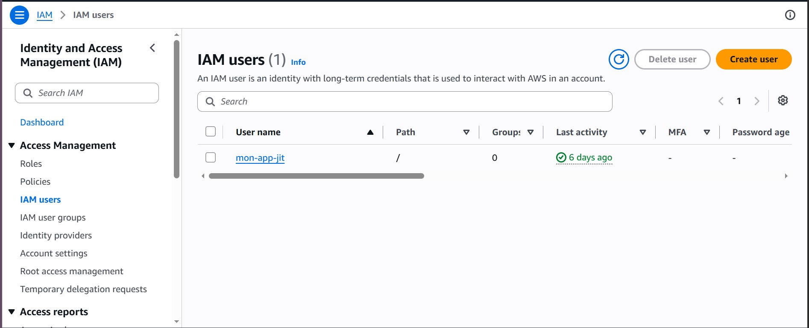 | 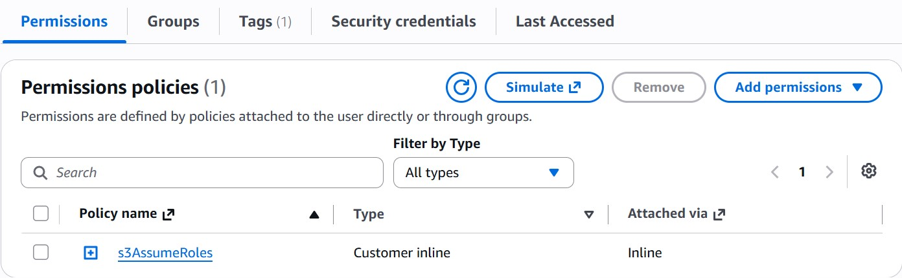 | 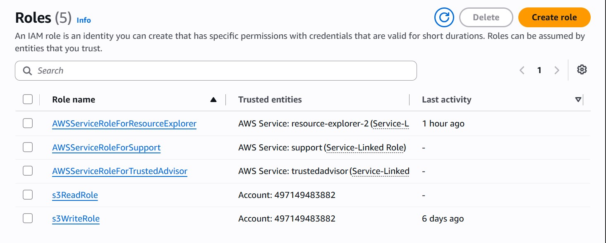 |

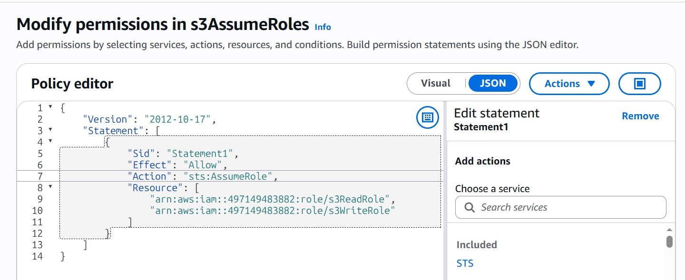
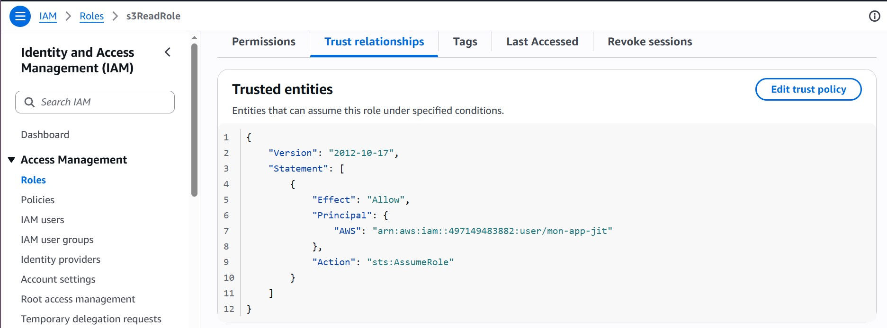
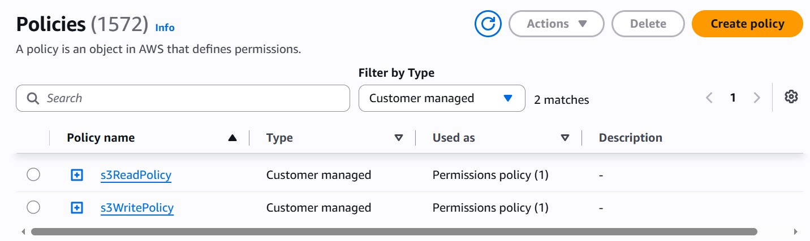
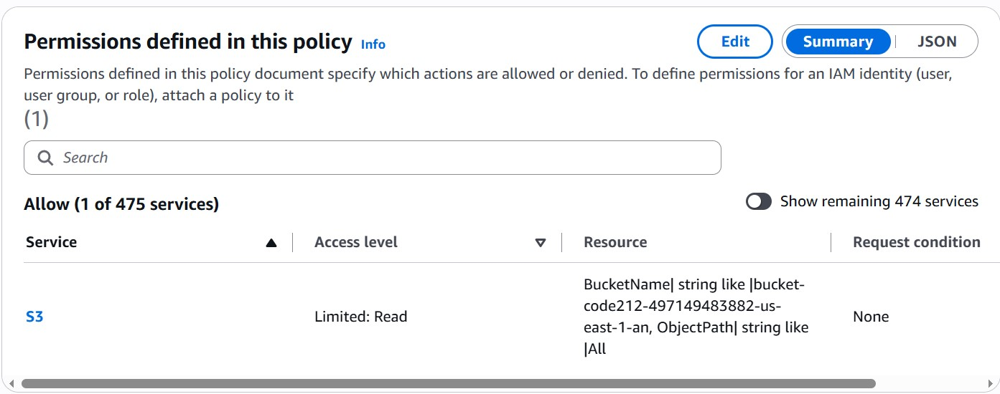
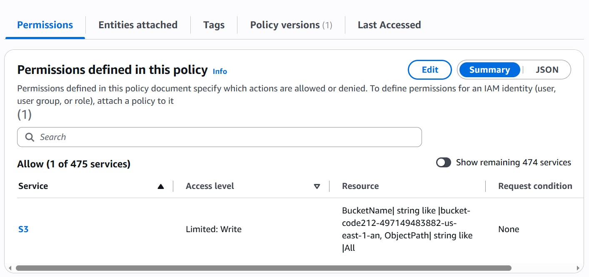
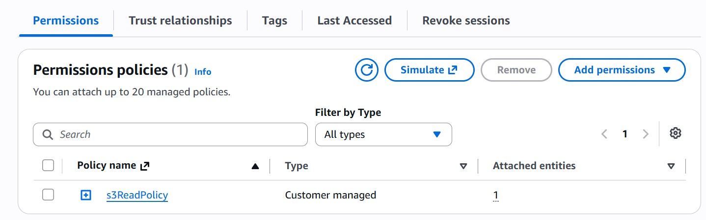
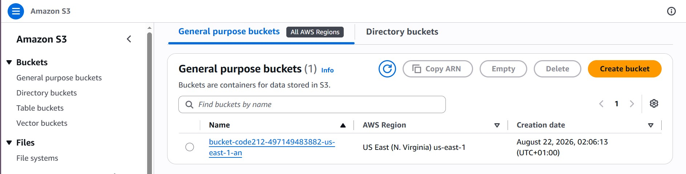

### 6. Agent local

`agent_jit.py` s'exécute sur le poste de l'utilisateur et expose un service HTTPS local. À la réception d'un `launch_token`, il contacte directement le backend pour un **retrait unique** des credentials, puis ouvre une session PowerShell avec :

- `AWS_ACCESS_KEY_ID`
- `AWS_SECRET_ACCESS_KEY`
- `AWS_SESSION_TOKEN`

Il surveille la date d'expiration et ferme la session à l'échéance. Même sans cette fermeture, les credentials STS deviennent invalides côté AWS.

---

##  Installation et lancement

### Prérequis

- Docker et Docker Compose
- Python 3
- Windows avec PowerShell (pour l'agent local) et AWS CLI
- Un compte AWS (utilisateur IAM, rôles et bucket S3 configurés comme ci-dessus)
- Une instance Jira Cloud avec un espace `JIT-Access` et un token API
- Une application d'authentification TOTP sur smartphone

### Étapes

```bash
# 1. Cloner le dépôt
git clone <url-du-depot>
cd jit-access

# 2. Générer les certificats auto-signés (développement)
python scripts/generate_local_cert.py

# 3. Démarrer l'infrastructure : PostgreSQL, Keycloak, OPA, Splunk
docker compose up -d

# 4. Installer les dépendances du backend
pip install -r backend/requirements.txt
```

Puis, dans trois terminaux PowerShell :

```powershell
.\start_backend_https.ps1     # API FastAPI    -> port 8000
.\start_frontend_https.ps1    # Interface web  -> port 5500
.\start_agent.ps1             # Agent local
```

### Ports utilisés

| Service | Port |
|---|---|
| Keycloak | 8080 |
| OPA | 8181 |
| Backend FastAPI | 8000 |
| Frontend (HTTPS) | 5500 |
| Splunk HEC | 8088 |

### Variables d'environnement du backend

| Variable | Rôle |
|---|---|
| `JIRA_BASE_URL`, `JIRA_EMAIL`, `JIRA_API_TOKEN` | Accès à l'API Jira |
| `SPLUNK_HEC_URL`, `SPLUNK_HEC_TOKEN` | Envoi des événements à Splunk |
| Identifiants AWS de l'utilisateur IAM applicatif | Appel à `AssumeRole` |


---

##  Démonstration

### 1. Connexion

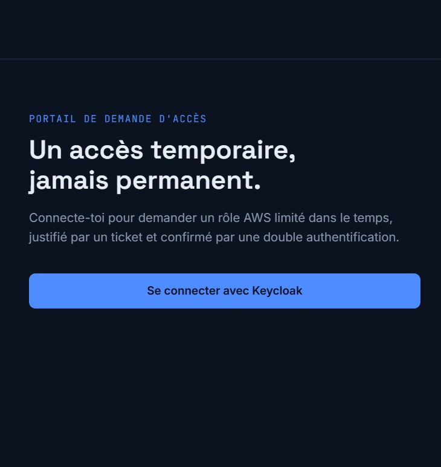

### 2. Soumission d'une demande

Le formulaire collecte le **rôle temporaire**, la **ressource cible**, la **référence du ticket Jira** et la **durée en minutes**. Un indicateur de progression suit les quatre étapes : TICKET → POLITIQUE → MFA → ACCÈS.

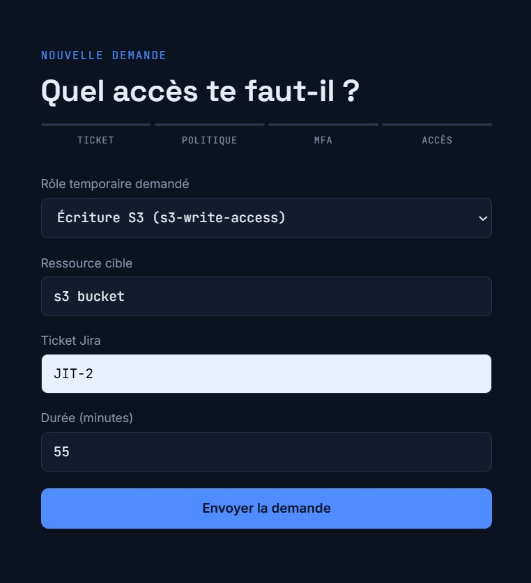

### 3. Refus par la politique

Ticket non assigné, priorité insuffisante, durée hors bornes ou rôle incompatible : la demande est rejetée avant toute MFA ou appel AWS.

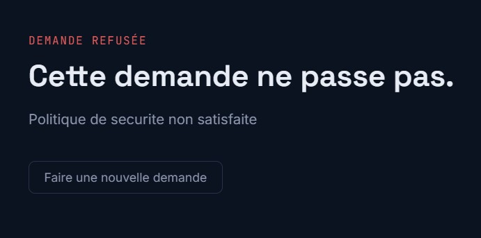

```json
{ "status": "denied", "reason": "Politique de securite non satisfaite" }
```

### 4. Authentification multifacteur

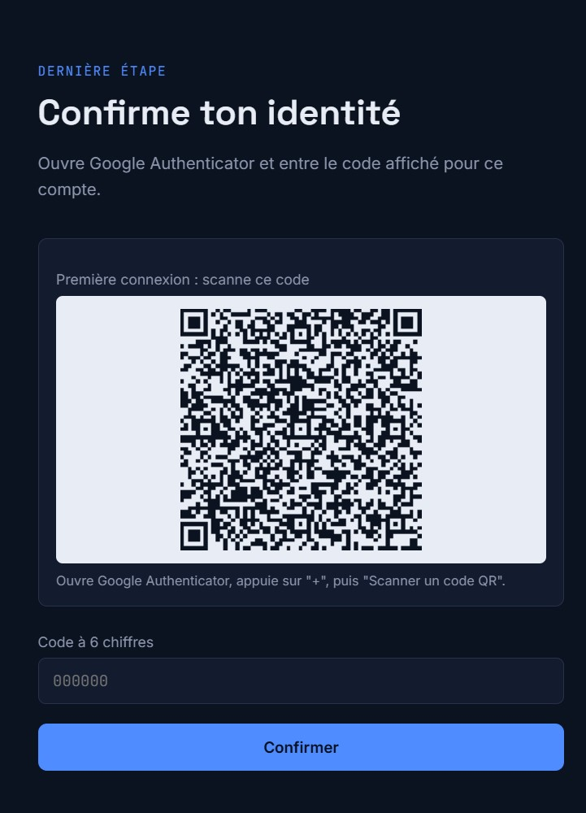

### 5. Octroi de l'accès

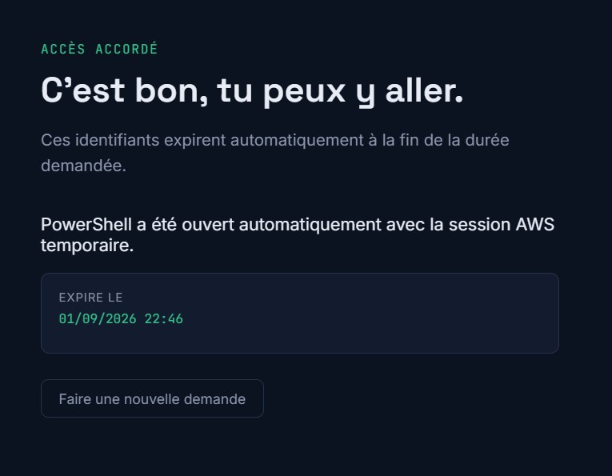

### 6. Session PowerShell et AWS CLI

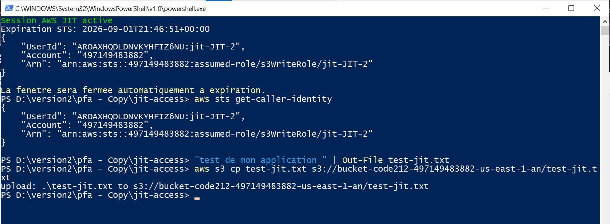

### 7. Vérification côté AWS

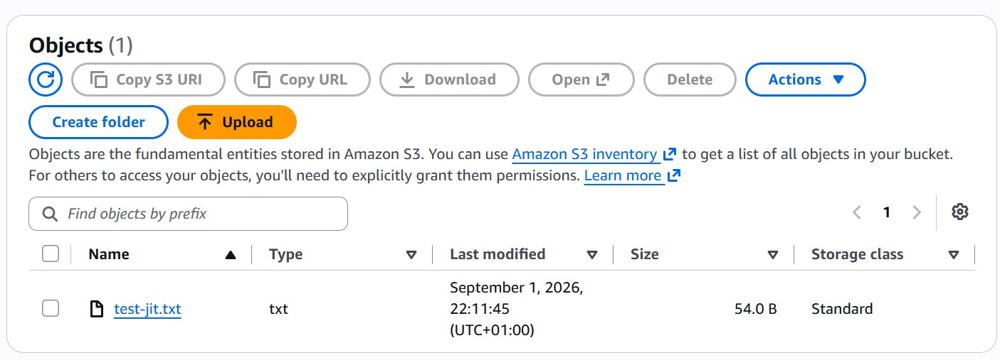

---

##  Traçabilité avec Splunk

Chaque événement est envoyé au HTTP Event Collector (sourcetype `jit_access_logs`) avec un `request_id` commun.

| Événement | Déclencheur |
|---|---|
| `access_denied` | Ticket introuvable ou demande rejetée par OPA |
| `mfa_required` | Demande autorisée, en attente du code TOTP |
| `mfa_failed` | Code TOTP invalide |
| `access_granted` | Provisioning AWS STS réussi |
| `provisioning_failed` | Erreur lors de `AssumeRole` |
| `agent_credentials_claimed` | Retrait des identifiants par l'agent local |

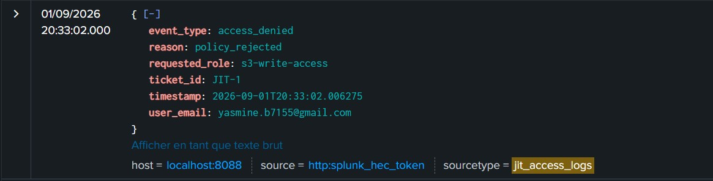
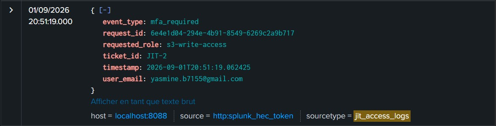
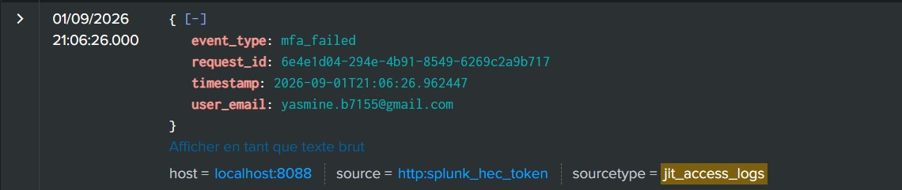
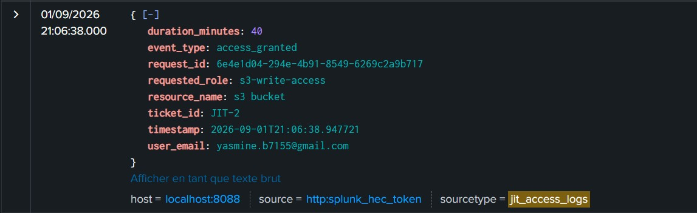
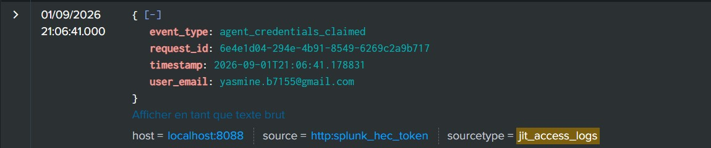

L'envoi est **non bloquant** : une panne de Splunk ne bloque jamais un utilisateur légitime. Seule la trace est perdue.

---

##  Choix de sécurité

- **Fail-closed partout** : refus par défaut dans OPA, refus si Jira est injoignable, aucun STS sans MFA.
- **Aucun mot de passe côté backend** : seuls des JWT signés sont vérifiés.
- **Aucun credential AWS dans le navigateur** : le frontend ne reçoit qu'un `launch_token` à usage unique et à courte durée.
- **Credentials éphémères** : durée alignée sur la demande (15 à 240 min) et expiration garantie par AWS.
- **Moindre privilège** : un rôle métier ne peut demander que les rôles temporaires prévus par la matrice.
- **Séparation des responsabilités** : authentifier (Keycloak), décider (OPA), exécuter (backend / STS), tracer (Splunk).
- **Poste légitime** : les credentials sont injectés dans une session locale, pas affichés pour être copiés ailleurs.
- **Transport** : HTTPS entre les composants locaux.

---

##  Limites et perspectives

**Limites actuelles**

- Demandes en attente et secrets TOTP stockés **en mémoire** (non persistants, mono-instance).
- Un seul fournisseur cloud (AWS) et un seul type de ressource (S3).
- Certificats TLS auto-signés, adaptés au développement local.
- Pas de limitation du nombre de tentatives TOTP.

**Pistes d'évolution**

- Alertes Splunk sur les échecs MFA répétés, et *rate limiting* des tentatives TOTP.
- Révocation anticipée d'une session AWS en cours.
- Persistance en base de données (demandes, secrets TOTP).
- Extension à EC2, RDS, Lambda, puis à Azure et GCP.
- Durée d'accès adaptative selon le niveau de risque.
- Certificats émis par une autorité de certification de production.
- Tests automatisés (`opa test`, endpoints FastAPI) et CI.
- Tableau de bord d'administration basé sur les données Splunk.


##  Auteure

**Aya Isedrhas** — élève ingénieure en Cyberdéfense, ENSA Marrakech.
Réalisé dans le cadre d'un stage PFA au Centre **Code212**, Université Cadi Ayyad.
